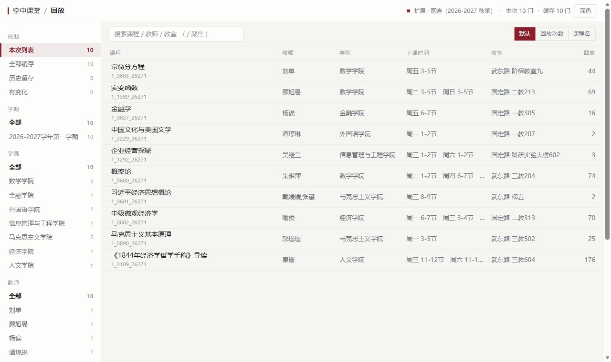
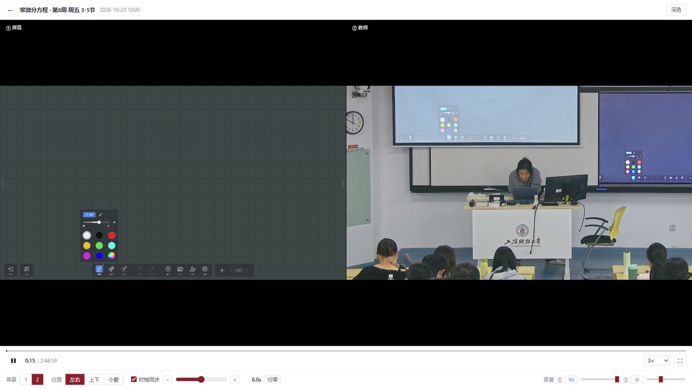
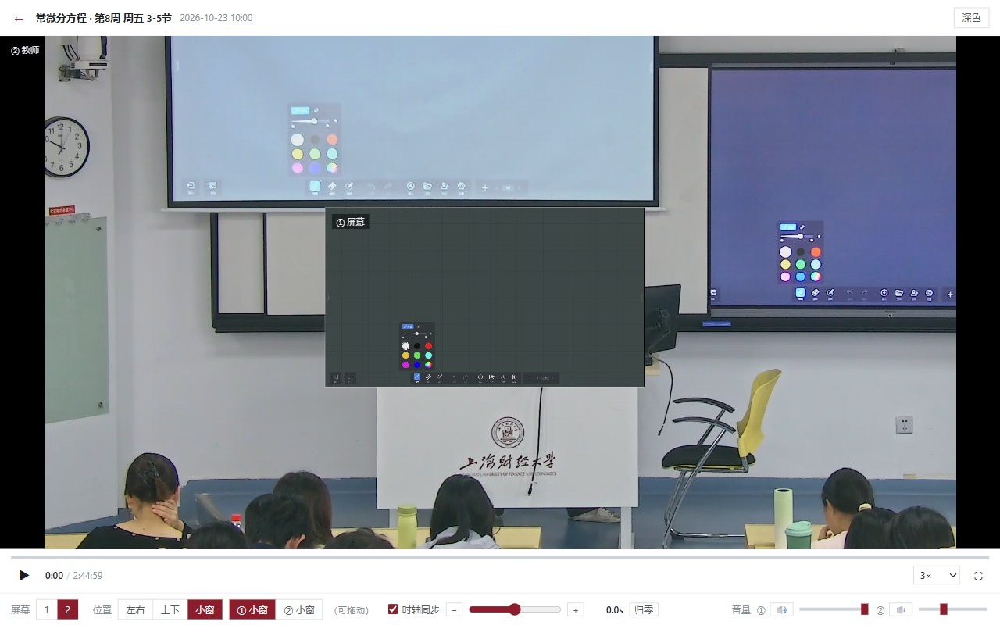
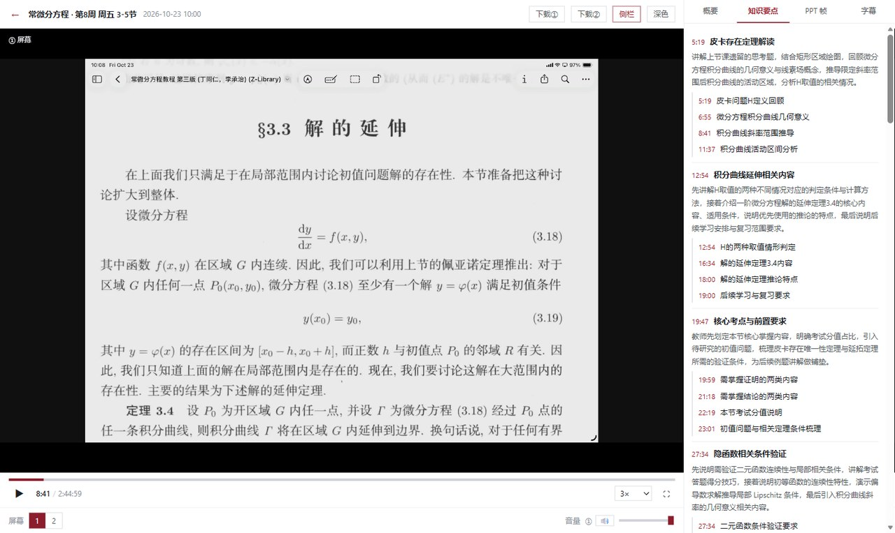
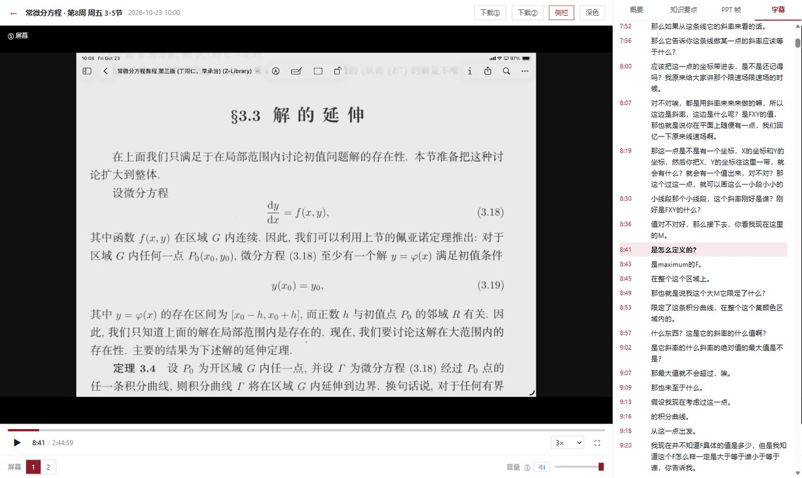

# SUFE 回放增强器

把上海财经大学（`dm.sufe.edu.cn`）的课程回放，换成一个真正好用的界面。

浏览器扩展（Edge / Chrome，MV3）。课程列表自己读、播放器自己写、双屏能对时间差、右侧栏的
知识点和字幕点一下就跳到那个时间点。全部跑在本机，没有后端，不碰账号密码。



| | |
|---|---|
|  |  |
|  |  |

> 只用自己已登录的会话读公开可读的 MP4，**不破解 DRM、不刷课、不传播**。
> 下载功能仅供个人离线复习；链接本身就是凭证，别外传。

## 一、探测结论（2026-10-26 实测）

对样例直链做了一次 HTTP 探测，结果如下：

| 项目 | 结果 | 含义 |
|---|---|---|
| `HTTP` | `200` → `206 Partial Content` | 支持断点续传 / 拖拽 |
| `Content-Type` | `video/mp4` | 标准 MP4，浏览器原生可播 |
| `Content-Length` | `2,599,656,804`（≈2.42 GiB） | 单节课一个整文件 |
| `Accept-Ranges` | `bytes` | **可以任意 seek** |
| `Access-Control-Allow-Origin` | `*` | **跨域可读**，截图/自定义播放器都成立 |
| `Server` / `X-Server-By` | `openresty` / `Sobey` | 索贝媒资（广电级录播系统） |
| `ftyp` | `isom / iso2 / avc1 / mp41` | H.264 + AAC |
| `moov` 位置 | 文件头（offset 32） | fast-start，边下边播不用等全片 |
| 鉴权 | 无 query 签名、无 Cookie 也返回 200 | 存储层为公开读 |

**结论：属于最理想的 C 路线（完全自建播放器）。**

- 不需要 hls.js，不需要解析分片，`<video src="…">` 直接用；
- `Range` 支持 + `moov` 前置 → 拖进度条秒响应；
- `ACAO: *` → 连 canvas 截图都不会被污染。

> 公开可读意味着**链接本身就是凭证**，不要外传或发到公开群组。本项目只做个人学习体验优化，不涉及下载传播。

## 二、现在的形态：重写过的课程列表页

`app/index.html` —— 一个页面。装着扩展时它能**自己去学校接口读数据**；没装扩展时也能当静态页用。

### 装成扩展（推荐，自动读取）

扩展的名字叫 **「空中课堂 · 回放」**（装完在扩展列表和标签页里都显示这个名字）。

1. `edge://extensions/` → 打开「开发者模式」→「加载解压缩的扩展」→ 选 `app` 文件夹；
2. 浏览器里登录一次 `dm.sufe.edu.cn`（没登录时页面顶部有「去登录」，点了直接跳统一认证）；
3. 点扩展图标打开页面 —— 刷新一次就会自动读到最新课表，不用跑脚本、不用导 JSON。

> 地址栏里那串 `chrome-extension://mnkhdbfkagnopdhcgdcjdkmpjohpffop/` 是浏览器给扩展分配的
> **ID**（每个扩展都有一个，装上就固定），不是乱码，也没法改名；能改的显示名、标签页标题、
> 图标都已经改成「空中课堂 · 回放」了。

细节（数据链路、权限、去重规则）见 [`docs/扩展与自动读取.md`](docs/扩展与自动读取.md)。

### 数据不在页面里

页面启动时按顺序找数据：

1. **有扩展**：让扩展去读学校接口（见上）；
2. 否则用浏览器里上一次存下来的数据（`localStorage`）→ 立刻渲染，秒开；
3. 再去读 `app/data/courses.json`，拿到新的就替换并记一次「读取」；
4. 都没有 → 显示空状态，让你起服务或者手动导入。

**不用扩展时的打开方式（二选一）**

| 方式 | 操作 | 说明 |
|---|---|---|
| 起本地服务（推荐） | 双击 `tools/start-server.cmd` | 起在 `127.0.0.1:8730` 并自动开浏览器，每次都是最新数据 |
| 直接双击 | 双击 `app/index.html` | 浏览器禁止网页读本地文件，要点侧栏「导入数据」选一次 `app/data/courses.json`；之后会记住 |

**更新数据**

```bat
node tools\fetch_courses.js
```

通过 CDP 连到你已登录的 Edge，调 `/learn/v1/course/video/review/-1`，把服务器返回的原始 JSON 写回 `app/data/courses.json`。
前置：Edge 用 `tools\start-edge-debug.cmd` 启动并已登录。

### 界面功能

- 左侧四组筛选：视图 / 学期 / 学院 / 教师
- 六列列表：课程 / 教师 / 学院 / 上课时间 / 教室 / 回放次数；点行展开详情
- 详情里的「回放画面」：按节次给出 **PPT / 屏幕** 与 **教师画面**；「双屏看」一次给两路，「播放」单路，「原片」直接开 MP4
- 播放器：单屏 / 双屏可切，位置可选左右、上下、小窗（**可指定哪一路进小窗，小窗能拖到任意位置并被记住**）；时轴同步 + 手动时间差（±20 秒，0.1 秒步进）；每一路独立音量；倍速 0.5–3、全屏；快捷键只有 `空格` / `←→` ±5 秒，详见 [docs/播放器.md](docs/播放器.md)
- 播放器右侧栏（单屏默认开、双屏默认收）：**概要 / 知识要点 / PPT 帧 / 字幕** 四个标签，每条带时间点的内容点一下就跳过去；字幕跟着播放走。数据只在内存里缓存 30 分钟，不落盘
- 顶栏 `下载①` / `下载②`：直接下载当前两路 MP4
- 详情最后的「数据来源」：这张课的每个接口从哪来、什么状态、多大、sha、什么时候取的（只记来源，不存正文）
- `/` 聚焦搜索、`Esc` 清空、右上角深色切换、按回放次数或课程名排序
- 风格：无圆角、无阴影、无动画，只用「上财红 + 中性灰」两种颜色

### 本地缓存（记录变化）

每次读到新数据就并进本地档案（`localStorage`，键 `sufe.replay.cache.v2`）：

- 同一份快照只记一次，刷新不会把「已记录 N 次」刷虚；
- 记下回放次数变化、教室/时间等字段变化、首次与最近出现时间；
- 这次列表里没有的课**不删除**，标成「历史留存」；
- 另记一本「数据来源账」：接口路径、状态码、响应字节数、内容指纹（sha）、条数、时间、调用次数 —— 摘要与字幕正文一律不入库；
- 四个视图：本次列表 / 全部缓存 / 历史留存 / 有变化；
- 侧栏可导出 JSON、**重置**（两步确认）：清空会连着「本次列表」一起丢掉，然后重新向学校要一次最新数据 —— 你看到的是全新的第 1 次读取，而不是「数据还在、只是计数没了」。

## 三、下一步路线

| 阶段 | 内容 | 状态 |
|---|---|---|
| P0 | 课程列表页 + 本地缓存 | 已完成 |
| P1 | 双屏播放器：教师画面 + 屏幕画面、左右/上下/小窗、同步与手动时间差 | 已完成（系统级浮窗 PiP 待做） |
| P2 | 接入真实登录态（扩展桥接同源请求），让同学装扩展就能用 | 已完成（`app/manifest.json`） |
| P3 | 重点总结 / 字幕 / PPT 帧 / 知识点跟着播放走 | 已完成（右侧栏，读完就跳） |
| P4 | 观看进度照常真实上报（不做静默刷时长） | 待做 |

## 四、开发备注

- `app/manifest.json` + `app/ext/` —— MV3 扩展外壳（`background.js` 取数、`content.js` 同源兜底、`bridge.js` 给页面用）
- **`app/app.js` 必须是外部文件**：MV3 扩展页 CSP 为 `script-src 'self'`，内联 `<script>` 会被拒绝执行（白屏），`tools/split_script.js` 就是当初拆出它的脚本
- `tools/serve.js` —— 本地静态服务（零依赖，端口 8730），`start-server.cmd` 调用它
- `tools/fetch_courses.js` —— 抓课程列表 → `app/data/courses.json`
- `tools/cdp.js` / `cdp_capture.js` / `cdp_eval.js` / `cdp_shot.js` —— 连已登录浏览器的调试端口抓包、取数、截图
- `tools/make_cache_test.js` —— 造两份假数据验证缓存合并（`?store=test` 隔离，不污染真实缓存）
- `tools/make_dist.js` —— 打试用包：按白名单拷 `app/` 到 `dist/空中课堂-回放-v<版本>/extension/`，**绝不带 `app/data/courses.json`（个人课表）**，并自检包里没有脚本、没有本机绝对路径
- `packaging/安装说明.txt` —— 给同学的说明书（安装 / 使用 / 隐私 / 常见问题），打包时一并拷进去
- `tools/probe_dist.js` —— 把 dist 里那份包**真的装一次**（`Extensions.loadUnpacked`），打开首页查状态、截图、再 `Extensions.uninstall` 卸掉，确认「发给别人的那份能跑」
- `tools/probe_video.py`（HEAD + Range + MP4 box 解析）、`tools/probe_site.py`
- 接口清单见 `docs/接口清单.md`，字段核对见 `docs/课程列表字段核对.md`
- 校验：`node --check`（JS 语法）
- 路径约定：视频 URL 形如
  `https://dm.sufe.edu.cn/bucket-z/ROLE_r_group_manager_<hash>/video/YYYY/MM/DD/<教室>/<md5>.mp4`
- 早期原型的单文件播放器仍在 `player/index.html`（已被 `app/` 取代，留作参考）

## 五、仓库结构

| 路径 | 内容 |
|---|---|
| `app/` | **现行版本**：MV3 扩展（课程列表 + 播放器 + 右侧栏 + 打包入口） |
| `docs/` | 逆向与设计记录：接口清单、页面架构、字段核对、缓存设计、播放器说明 |
| `tools/` | 抓包 / 取数 / 截图 / 打包脚本（node，零依赖） |
| `packaging/` | 发给同学的说明书 |
| `extension/` | v0.1 原型，基于当时的错误鉴权假设（`localStorage` token），**已作废**，留作记录 |
| `player/` | 更早的单文件播放器原型 |

## 六、特意没进仓库的东西

`.gitignore` 挡掉三类：

- `app/data/courses.json` —— 抓下来的课表里带着自己的学号（`userCode`）；
- `probe/` —— 抓包记录里有会话 Cookie（`S1_rman_sid`），推上去等于交出登录态；
- 学校页面原始源码 `源代码.txt`、以及 `dist/` 打包产物（用 `node tools/make_dist.js` 重新生成）。

如果你 fork 了这份仓库并想自己抓数据，记得同样别把这两类push 上去。

